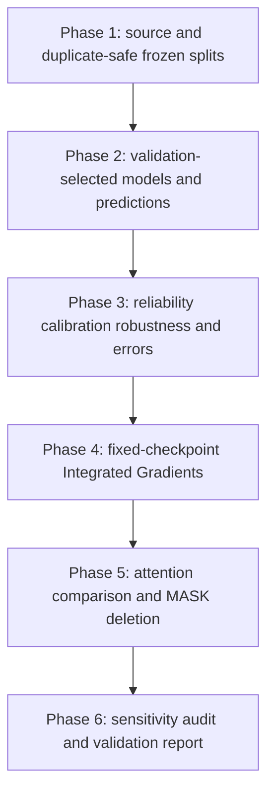

# 00 — Start with a financial sentence

**Before you begin:** no project-specific knowledge is needed. By the end, you should be able to explain what the project asked, how it tested the answers and what it still cannot claim. Leave unfamiliar metric names in the results table for their linked lessons; you do not need their formulas yet.

## Learning objectives

- Explain the task using a financial sentence.
- Describe the six-phase workflow and its boundaries.
- Give the project story in 30 seconds, 2 minutes and 10 minutes.

## Lesson: What are we asking the computer to do?

### Why it matters
Imagine an analyst receiving hundreds of financial headlines. Which ones sound favorable, unfavorable or mainly factual? Reading everything takes time. A model might help sort the queue, but we need to know when its suggestions are dependable.

### Build the intuition
Our model reads one sentence and chooses one of three labels: positive, negative or neutral. Think of it as a sorting assistant. It is not being asked to predict tomorrow's share price.

### A concrete example
**Invented teaching examples:**

| Sentence | Plausible sentiment in this simplified example |
|---|---|
| “Operating profit increased from EUR 10 million to EUR 12 million.” | Positive |
| “Operating losses increased from EUR 10 million to EUR 12 million.” | Negative |
| “The company will publish its report on Tuesday.” | Neutral |

The first two sentences contain the same numbers and the word “increased.” What increased changes the meaning.

### Walk through it
1. Read the sentence, including the financial quantity being discussed.
2. Ask whether the statement sounds favorable, unfavorable or mainly factual.
3. Let the model make the same three-way choice.
4. Compare its choice with the dataset's human-assigned label.
5. Inspect mistakes rather than assuming the model understands the financial relationship.

### Give the idea its technical name
This is **financial sentiment classification**: assigning a financial-language example to a sentiment category. A **label** is the category attached to an example. Here, labels come from human judgments.

### Add the mathematics
The computer stores labels as numbers: negative = 0, neutral = 1, positive = 2. These are names in numerical form, not a scale where positive is “twice neutral.” A model might return probabilities `[0.10, 0.15, 0.75]` in that order. It chooses positive because 0.75 is largest. We will explain how it produces those probabilities in [Chapter 01](01_foundations_and_theory.md).

### Connect it to our project
The project uses Financial PhraseBank, a collection of labeled financial sentences. [data.py](../src/finbert_explainability/data.py) defines the label order. The final evaluation uses the same 727 test sentences for all independently trained workflows.

### Alternatives and trade-offs
A word-list rule is cheap, but “increased” shows why individual words are not enough. A language model can use surrounding words, but costs more and can still learn shortcuts. A human-review queue is a plausible use; autonomous trading is outside the evaluated task.

### Check your understanding
**Question:** If the model labels “profits increased” correctly, have we shown that it can predict profitable trades?

**Answer explained:** No. We tested agreement with sentiment labels. Trading would require different targets, future-market data and a separate evaluation of decisions and costs.

### Deeper dive and common confusion
**Common confusion:** a correct label does not prove the model used the right reasoning. It might react to “increased” even when the subject is losses. Later chapters test this possibility with controlled edits. Those tests also have limits: a changed sentence needs its own reviewed label before we can call the new prediction correct or wrong.

## Lesson: How do six phases turn a model into evidence?

### Why it matters
Suppose a model gets an excellent score because a nearly identical headline appeared during training. The score looks impressive, but it may tell us little about genuinely new sentences. We need a process that can catch that problem.

### Build the intuition
Treat the project like a practical exam. Training examples are the practice questions. Validation examples help choose a study strategy. Test examples are the final exam. Explanations are then another claim to examine, not a decorative chart added after the score.

### A concrete example
**Invented teaching example:** “Acme profit rose 10%” appears in practice, while “Acme's profit rose 10 %” appears in the exam. A punctuation difference should not make us call them completely independent evidence.

### Walk through it
1. **Phase 1:** find similar sentences, keep related groups together, and save the assignments.
2. **Phase 2:** train the models, choose settings using validation examples, then evaluate on test examples.
3. **Phase 3:** ask where predictions fail and whether confidence is trustworthy.
4. **Phase 4:** assign contributions to input tokens for a fixed saved model.
5. **Phase 5:** compare those contributions with attention and test what happens when selected tokens are replaced.
6. **Phase 6:** recalculate results from saved records, inspect exclusions, and write a bounded validation report.

### Give the idea its technical name
A **split** is a division of examples into training, validation and test groups. **Data leakage** occurs when the evaluation benefits from information it should not have had. An **artifact** is a saved output such as a prediction file or checkpoint. A **checkpoint** is a saved model state.

### Add the mathematics
Our saved split has 3391 training + 728 validation + 727 test rows = 4846 total. The intended proportions are 70/15/15; indivisible duplicate groups and integer row counts make exact percentages impractical. Nothing was dropped to make the totals look neat.

### Connect it to our project
The code path is [Phase 1 pipeline](../src/finbert_explainability/pipeline.py) → [Phase 2 workflows](../src/finbert_explainability/phase2/workflows.py) → [Phase 3 analysis](../src/finbert_explainability/phase3/pipeline.py) → [IG core](../src/finbert_explainability/phase4/core.py) → [attention/deletion](../src/finbert_explainability/phase5/inference.py) → [final audit](../src/finbert_explainability/phase6/audit.py). Each stage reads earlier evidence and saves new outputs.

### Alternatives and trade-offs
A single random split is simpler, but can separate duplicate headlines. Keeping entire news events or time periods apart could test stronger forms of independence, but needs reliable event or date information. The present lexical detector checks text similarity; it cannot prove that all meaning-level overlap is gone.

### Check your understanding
**Question:** Can we choose the settings that give the highest test score and still call that test an untouched exam?

**Answer explained:** No. Once test results guide the choice, they are helping us practice. We need separate examples to assess the resulting choice fairly.

### Deeper dive and common confusion
The project saves file hashes: fingerprints used to detect changed bytes. A hash tells us a file stayed the same; it does not tell us the labels are correct. Similarly, the test can remain byte-identical while repeated inspection influences future research ideas. That is why future improvement claims need a new independent holdout—a set reserved for confirmation, not development.

## Lesson: What did we actually learn?

### Why it matters
The project name might make you expect FinBERT to win. What should we do when general BERT gets the higher score? Report the result, then separate what happened from our guesses about why.

### Build the intuition
We asked several different questions. How often does a model classify well across all three classes? Does it know when it is likely to be wrong? Do two explanation methods highlight similar tokens? Does hiding their highlighted tokens weaken the prediction? A good answer to one question does not automatically answer the others.

### A concrete example
**Measured finding:** general BERT's mean macro-F1 is 0.8476; FinBERT's is 0.8339. Macro-F1 is a score that gives each of the three classes equal importance; [Chapter 05](05_evaluation_and_validation.md) calculates it from actual counts. For now, read higher as better on that particular classification score.

### Walk through it
1. Compare models on the same saved examples.
2. Repeat training with three fixed random starting sequences, called seeds.
3. Report the average and the variation across runs.
4. Inspect agreement groups, confidence and mistakes.
5. Compare explanation methods without assuming either is the correct answer.

### Give the idea its technical name
A **measured finding** is something the saved results show. An **interpretation** is a reasoned reading of those results. A **hypothesis** is a possible explanation that still needs a test. A **proposal** describes work we have not done.

### Add the mathematics
Subtract the displayed scores: 0.8476 − 0.8339 = 0.0137, or about 1.37 percentage points. This tells us the size and direction of the displayed difference. It does not identify its cause or prove the same winner on future data.

### Connect it to our project
The table below preserves the measured headlines. Each row has a later lesson that explains its calculation. The separate ProsusAI model scored 0.8797 F1, but its earlier training included PhraseBank; some local test examples may not be new to it. We therefore do not treat it as an independent winner.

### Alternatives and trade-offs
We could report only the best score. That is shorter, but hides confidence errors, difficult examples and explanation failures. We could demand a full production trial before reporting anything, but that answers a broader question. This project supports research conclusions and a cautious human-review recommendation, not production certification.

### Check your understanding
**Question:** Does “BERT scored higher” justify saying “financial pretraining made FinBERT worse”?

**Answer explained:** No. The workflows differ in more than one way, including their starting weights and vocabulary. A small search and only three seeds also leave uncertainty. Chapter 11 designs tests of competing explanations instead of presenting one as proven.

### Deeper dive and common confusion
**Common confusion:** a colorful token explanation is not automatically a faithful account of the prediction. Here “faithful” means it reflects the model behavior it claims to describe. Numerical accuracy, human plausibility and causal evidence are separate questions. We build those distinctions gradually in Chapters 07–09.

## Keep the whole project in view

### The results, translated before the technical detail

| Everyday reading | Saved result | Where we unpack it |
|---|---|---|
| General BERT performed better on the main class-balanced score | TF-IDF 0.6713; BERT 0.8476; FinBERT 0.8339 | [05](05_evaluation_and_validation.md) |
| Examples people agreed about were much easier for BERT | Allagree 0.9583; non-allagree 0.7500 macro-F1 | [05](05_evaluation_and_validation.md) |
| The two token rankings agreed somewhat, but far from perfectly | Mean Spearman 0.2406 over 687 sentences | [09](09_explainability_experiments.md) |
| Both selected rankings weakened the original prediction more than random masking on average | IG / attention / random probability AUC 0.6555 / 0.6608 / 0.7866 | [09](09_explainability_experiments.md) |
| We could not clearly separate IG from attention in that comparison | Paired difference 95% interval [-0.0130, 0.0024] includes zero | [09](09_explainability_experiments.md) |
| Some IG calculations did not meet the fixed numerical accuracy rule | 40 of 727 retained and flagged | [07](07_integrated_gradients.md), [09](09_explainability_experiments.md) |

**Check:** Is 0.2406 an accuracy of 24.06%? **Answer:** No. It measures agreement between token rankings, not correctness of sentiment predictions. Different columns answer different questions.

### Explain the project at different lengths

**30 seconds.** I studied how well language models classify financial sentences and how much we can trust their explanations. I prevented detected duplicate sentences from crossing data splits, compared a simple model with general and financial BERT, and checked confidence and errors. General BERT had the higher average class-balanced score. For one fixed FinBERT model, I compared gradient-based token contributions with attention. Neither explanation method clearly won the paired comparison, and I kept all numerical failures visible.

**Two minutes.** Start with “profits rose” versus “losses rose”: financial sentiment needs context. I used human-labeled financial sentences, grouped detected duplicates, and froze training, validation and test assignments. Models learned only from training rows; validation rows selected settings. Three final runs per supervised workflow helped show how much training randomness mattered.

General BERT's mean macro-F1 was 0.8476, versus 0.8339 for financial BERT and 0.6713 for TF-IDF. I do not know the isolated cause of the BERT–FinBERT gap. The ProsusAI checkpoint was kept separate because its original training may overlap this test. Models did much better on unanimous human labels. Their confidence and reactions to edited sentences also needed qualification.

I then fixed FinBERT seed 42, rather than choosing an attractive test run. Integrated Gradients assigns token contributions relative to a reference input. Changing the reference changed rankings. I compared those rankings with attention and replaced selected tokens with MASK. Both suppressed predictions more than random ordering on average, but the uncertainty interval for IG versus attention included zero. Forty calculations missed the unchanged numerical tolerance and remained in a separate sensitivity analysis. The result is a reproducible research study, not proof that a model or heatmap is safe for autonomous financial decisions.

**Ten-minute route.** Spend 1 minute on the sentence examples; 2 on data and duplicate grouping; 2 on model choices and validation-only selection; 1 on the confusion matrix and agreement groups; 1 on confidence; 2 on IG, attention and masking; 1 on the uncertain findings and next independent evaluation. Use [the timed 30-minute interview](interview_preparation.md) for the longer version.

**Check:** Which sentence should follow “BERT won”? **Answer:** “Under this benchmark and evaluation procedure; the reason and wider generalization need further testing.” That is a boundary on the evidence, not an excuse for it.

### Find the saved work

The outputs include saved data splits, prediction files, model checkpoints, search records, error-review CSVs, explanation records, figures, a five-page report and publication-preparation files. The [coverage matrix](coverage_matrix.md) maps all six phases to chapters. The [comparison JSON](../artifacts/phase2/comparison/comparison.json), [Phase 3 report](../PHASE3_RESULTS.md) and [sensitivity JSON](../artifacts/phase6/audit-final/ig_sensitivity.json) support the figures above.

**Check:** Do we need to retrain to read these results? **Answer:** No. This course uses completed records. Reproduction is a separate, explicitly authorized activity with fresh outputs.

## Practice explaining it

1. **What is the model sorting?**

   English financial sentences into negative, neutral and positive sentiment.

2. **Why do “profit rose” and “loss rose” matter?**

   They show why a word can have different financial implications depending on its context.

3. **What are validation examples for?**

   Choosing settings before the final evaluation.

4. **What did the BERT comparison show?**

   A higher observed mean for general BERT, without a proven causal explanation.

5. **Why keep failed explanations?**

   They reveal limits of the numerical procedure and can change which examples the conclusion describes.

## Sources and next lesson

Read the [final validation report](../artifacts/phase6/MODEL_VALIDATION_REPORT.md), [model card](../publication/MODEL_CARD.md), [Phase 6 results](../PHASE6_RESULTS.md) and [reference catalog](references.md). Continue with [foundations](01_foundations_and_theory.md).
