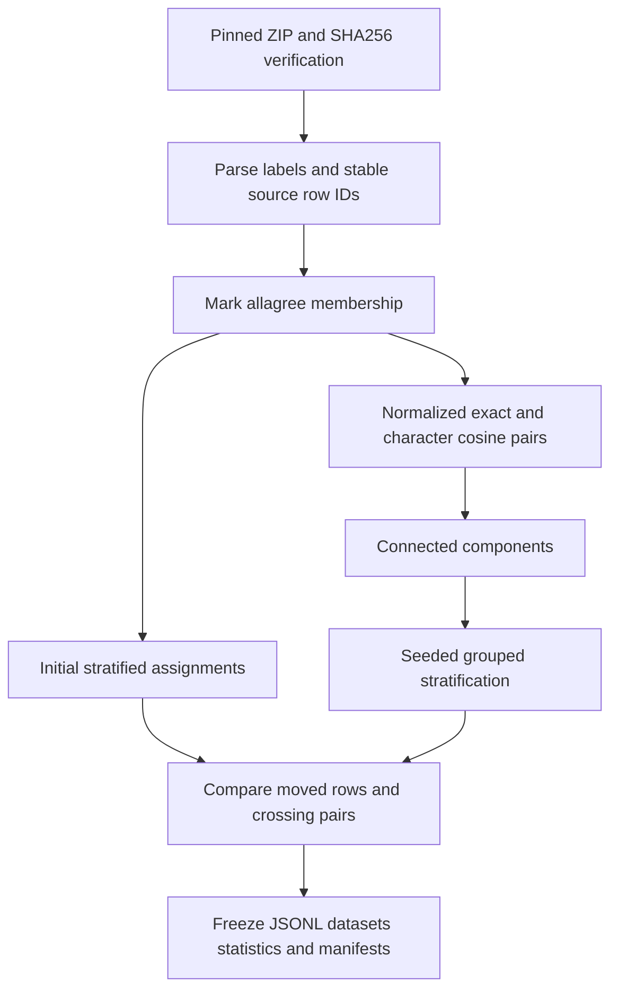

# 02 — Make the exam fair before judging the model

**Before you begin:** Chapter 00 explains training, validation and test. Here we build the dataset decisions from the questions a skeptical reviewer would ask: who labeled the sentences, how similar are they, and did the same examples stay in the same splits?

## Learning objectives

- Interpret agreement thresholds without inventing votes.
- Explain stratification, duplicate groups and the 2199 moved assignments.
- Distinguish frozen-file integrity from complete protection against leakage.

## Lesson: What do the human labels tell us—and not tell us?

### Why it matters
Two readers may disagree about whether a contract announcement is good news or simply factual. If we train and test on such sentences, we should know that the disagreement exists.

### Build the intuition
PhraseBank includes versions with different levels of agreement. Choosing a larger version gives us more examples, including harder-to-agree-on sentences. Choosing only unanimous examples gives cleaner agreement but changes what we are testing.

### A concrete example
**Invented vote example:** if 6 of 8 readers choose positive, agreement is 75%. If all 8 choose it, agreement is 100%. The real project's source does not provide each sentence's full vote counts; this toy example only explains a proportion.

### Walk through it
1. Load the 50agree collection.
2. Read each sentence and its assigned sentiment.
3. Read the allagree collection separately.
4. Match sentence-plus-label pairs after a declared text cleanup.
5. Store whether each main-dataset row appears in the unanimous collection.

### Give the idea its technical name
**Annotation** is the act of assigning a human label. **Agreement** describes how much annotators agreed. The four configurations are `sentences_50agree`, `sentences_66agree`, `sentences_75agree` and `sentences_allagree`. They overlap; they are not four independent datasets. The archive describes strict greater-than threshold membership for the first three.

### Add the mathematics
For the teaching votes, agreement = 6/8 = 0.75; disagreement = 2/8 = 0.25. Because threshold membership gives only an interval, a row's disagreement band cannot tell us whether it had 6/8 votes or some other voting pattern. Exactly 75% also differs from strictly greater than 75%.

### Connect it to our project
[data.py](../src/finbert_explainability/data.py), through `read_subset` and `annotate_membership`, parses the pinned archive and adds stable IDs and `is_allagree`. There are 4846 rows and 2264 allagree members. The archive is decoded as Latin-1; exported project files use their recorded encoding. We do not infer exact votes.

### Alternatives and trade-offs
Using allagree only reduces ambiguity but loses examples and excludes much of the intended language. Keeping 50agree preserves coverage and allows agreement-group evaluation. Actual per-class vote proportions would support richer training targets, but they are not available here.

### Check your understanding
**Question:** Does non-allagree mean the label is definitely wrong?

**Answer explained:** No. It means at least some annotators disagreed. The majority label may still be reasonable, and disagreement can reflect subtle or incomplete context.

### Deeper dive and common confusion
**Common confusion:** membership is matched using both normalized text and label. Text alone could confuse cases with different labels. Normalization here applies Unicode NFKC, case folding and whitespace cleanup. NFKC standardizes certain Unicode forms; case folding ignores case differences. Original model text is retained rather than replaced with the matching key.

## Lesson: Build a fair practice set and exam

### Why it matters
If almost every example is neutral, a random small test could contain too few negative cases to assess them. We want all splits to retain a similar sentiment mix.

### Build the intuition
Divide the examples while keeping roughly the same fraction of each class in training, validation and test. This makes class coverage more predictable. It does not make the classes equally common.

### A concrete example
**Actual source counts:** 604 negative, 2879 neutral and 1363 positive. Neutral is the largest group. The final test has 91 negative, 432 neutral and 204 positive.

### Walk through it
1. Reserve about 70% for training.
2. Divide the remaining 30% approximately equally into validation and test.
3. Preserve class proportions during the initial split.
4. Apply the duplicate-group rule from the next lesson.
5. Save the resulting assignments instead of recreating them casually later.

### Give the idea its technical name
**Stratification** means preserving the representation of chosen categories during a split. **Class imbalance** means the classes occur at unequal frequencies. A **seed** fixes the starting state of pseudorandom choices so the same declared procedure can be repeated.

### Add the mathematics
The intended row targets are 4846×0.70 = 3392.2 and 4846×0.15 = 726.9 for each smaller split. Rows cannot be fractional, and duplicate groups are indivisible. Final counts are 3391/728/727. Their sum remains 4846.

### Connect it to our project
[`stratified_split`](../src/finbert_explainability/splitting.py) makes two sklearn splits. The final grouped splitter optimizes class counts. [phase1.json](../configs/phase1.json) records fractions and the seed; [statistics.json](../artifacts/phase1/statistics.json) records actual balances. Allagree membership was not a stratification variable.

### Alternatives and trade-offs
A class-by-agreement split could explicitly balance both properties, but would define a different benchmark. Company-separated or chronological splits ask stronger generalization questions, but require trustworthy company/event/date metadata. Never silently replace the saved test with a newly preferred design.

### Check your understanding
**Question:** Does stratification give us the same number of negative and neutral examples?

**Answer explained:** No. It preserves their approximate proportions. Neutral remains common; macro-F1 later prevents that majority from entirely driving the main score.

### Deeper dive and common confusion
**Common confusion:** a 70/15/15 target is a design goal, not a reason to drop examples or split a duplicate group. Store row IDs and assignments so later phases evaluate the exact same sentences.

## Lesson: Keep look-alike headlines on the same side of the split

### Why it matters
“Acme sales rose 5%” in training and “Acme sales rose 5 %” in test would give the model an easy exam question. How can we detect that without pretending to understand every sentence's meaning?

### Build the intuition
First look for exactly matching cleaned text. Then compare small character fragments to catch close wording. Join detected pairs into groups, and keep every member of a group in one split.

### A concrete example
**Invented grouping example:** A resembles B, and B resembles C. Even if A and C are not similar enough directly, putting A in training and C in test risks carrying the same story across the boundary through B.

### Walk through it
1. Clean matching text with the fixed normalization.
2. Find exact matches.
3. Represent each sentence by character fragments of lengths 3, 4 and 5 within word boundaries.
4. Weight fragments by how distinctive they are and compare the vectors.
5. Add an edge between pairs whose similarity is at least 0.90.
6. Find all connected groups and assign whole groups to a split.

### Give the idea its technical name
A **character n-gram** is n adjacent characters. **TF-IDF** weights a fragment using its frequency in a sentence and how uncommon it is across the collection. **Cosine similarity** compares the direction of two vectors rather than their raw length. A **connected component** contains sentences linked by a chain of detected pairs.

### Add the mathematics
For vectors a and b, cosine is $(a\cdot b)/(\|a\|\|b\|)$. The dot means multiply corresponding coordinates and add; the norm bars mean vector length. Toy vectors `[1,0]` and `[0.95,0.31225]` have approximately unit length and cosine 0.95, so they pass 0.90.

One standard smoothed inverse-frequency weight is $\log((1+N)/(1+df))+1$: N is the number of fitted sentences, and df is how many contain the fragment. Rare fragments receive larger weights. This duplicate detector is separate from the train-only word TF-IDF classifier.

### Connect it to our project
[`detect_duplicates`](../src/finbert_explainability/leakage.py) uses `char_wb`, n-grams (3,5), brute-force cosine neighbors and query batches of 256. `connected_groups` merges pair memberships. The saved report has 8 exact pairs, 49 near pairs and 4789 components. Cross-split detected pairs fell from 25 initially to zero finally.

### Alternatives and trade-offs
Word matching is simpler but more brittle to small spelling changes. Semantic embeddings could catch paraphrases with little shared spelling, but can also merge sentences with different financial implications. Grouping related text conservatively protects the evaluation without claiming their labels are interchangeable.

### Check your understanding
**Question:** Does zero detected crossings prove no possible leakage?

**Answer explained:** No. It means none under this exact detector. Paraphrases, shared events or exposure during a model's earlier pretraining can remain.

### Deeper dive and common confusion
**Common confusion:** the detector fits its character statistics to the corpus to construct groups before the split is frozen. The downstream classifier's TF-IDF is fitted only on training text. These are different uses. Grouping before splitting is a disclosed construction rule; it is not a license to fit predictive features on the test.

## Lesson: Why 2199 assignments moved—and why we save hashes

### Why it matters
A report says 2199 rows changed split. That sounds like thousands of duplicates. The actual pair report is much smaller. Which number describes what?

### Build the intuition
The algorithm did not move only the troublesome pairs. Once grouping was needed, it rebuilt the entire seating plan. Even a person sitting alone can get a different seat when every table is reassigned.

### A concrete example
**Measured finding:** 2199 assignments moved: 2143 singletons and 56 rows in duplicate groups. No row was lost. The objective balances class counts, not the number of rows moved from the initial plan.

### Walk through it
1. Gather rows into components.
2. Shuffle group order with a fixed seed, then consider larger groups first.
3. Try adding a group to each split and measure the change in class-count error.
4. Choose the smallest cost, using deterministic tie behavior.
5. Repeat for every group, including singletons.
6. Save assignments and fingerprints of the files.

### Give the idea its technical name
This is **greedy group-stratified splitting**: make one locally best placement at a time while keeping groups intact. A **hash** is a file fingerprint. A **manifest** records such fingerprints for a set of outputs.

### Add the mathematics
For split s and class c, call its current count C, its target T, and the incoming group's class count a. The contribution to the placement cost is $((C+a-T)^2-(C-T)^2)/\max(T,1)$, summed across classes. If C=8, T=10 and a=1, the cost is `(1−4)/10 = −0.3`: adding the row improves this part of the balance. There is no term penalizing a changed old assignment.

### Connect it to our project
[`grouped_stratified_split`](../src/finbert_explainability/splitting.py) implements that cost. [Phase 2 audit](../artifacts/phase2/audit/audit.json) confirms deterministic replay and matching saved assignments. The frozen test SHA256 is `97ad15089bd04e0d61726a6218bfcc2bdb18a4bcc1f5e8a299e1da41607e36a9`. The source archive and dataset revision are pinned in the config.

### Alternatives and trade-offs
A minimal-movement repair could retain more initial assignments, but that was not this algorithm's objective. Saving only a seed is smaller than saving all assignments, but code, library versions or input order can change a replay. Saved IDs plus hashes make the historical evidence much easier to check.

### Check your understanding
**Question:** Does a matching hash prove the sentence's label is correct?

**Answer explained:** No. It proves the bytes match the referenced file. A wrong label can be preserved perfectly. Integrity and scientific validity are different questions.

### Deeper dive and common confusion
**Common confusion:** deterministic means the declared procedure repeats under its conditions, not that every future software environment must behave identically. Allagree train/validation/test counts are 1592/334/338, with class counts 210/970/412, 43/212/79 and 50/209/79. Report these rather than assuming agreement was explicitly balanced.

## Follow the saved data through the code

| Population | N | Negative | Neutral | Positive |
|---|---:|---:|---:|---:|
| Full source | 4846 | 604 | 2879 | 1363 |
| Train | 3391 | 422 | 2015 | 954 |
| Validation | 728 | 91 | 432 | 205 |
| Test | 727 | 91 | 432 | 204 |
| Test allagree | 338 | 50 | 209 | 79 |
| Test non-allagree | 389 | 41 | 223 | 125 |

`load_source` verifies the original ZIP hash. `read_subset` turns its text into a Hugging Face Dataset with the declared class labels. `annotate_membership` adds IDs based on original source indices and unanimous membership. The pipeline writes JSONL splits, a saved dataset, statistics, initial assignments and a leakage report.

See [metadata](../artifacts/phase1/metadata.json), [initial assignments](../artifacts/phase1/initial_assignments.json) and [leakage report](../artifacts/phase1/leakage_report.json). The detector can miss semantic paraphrases and related events; it can also group wording that differs in an important number or negation. Grouping is a precaution, not permission to relabel or delete those sentences.

**Check:** Which would test future-news performance better: another random split of the same collection or a properly collected later-time holdout? **Answer:** The later-time holdout addresses the future-use question more directly, though time shifts can make it harder. It needs new provenance and label review; this saved test stays unchanged.

## Practice explaining it

1. **Why use 50agree?**

   It retains more examples and ambiguity; using only unanimous examples changes the target population.

2. **Why keep connected components together?**

   Pairwise similarity can form a chain of related sentences across splits.

3. **What moved 2199 rows?**

   A full grouped reallocation, not the discovery of 2199 duplicates.

4. **What does cosine 0.90 mean?**

   A threshold on a particular lexical vector similarity, not 90% identical meaning.

5. **Why save row IDs and hashes?**

   IDs align records across phases, and hashes detect changed bytes.

## Sources and next lesson

[Source metadata](../artifacts/phase1/metadata.json), [initial assignments](../artifacts/phase1/initial_assignments.json), [split code](../src/finbert_explainability/splitting.py), [reference catalog](references.md). Next: [model architecture](03_model_architecture.md).
