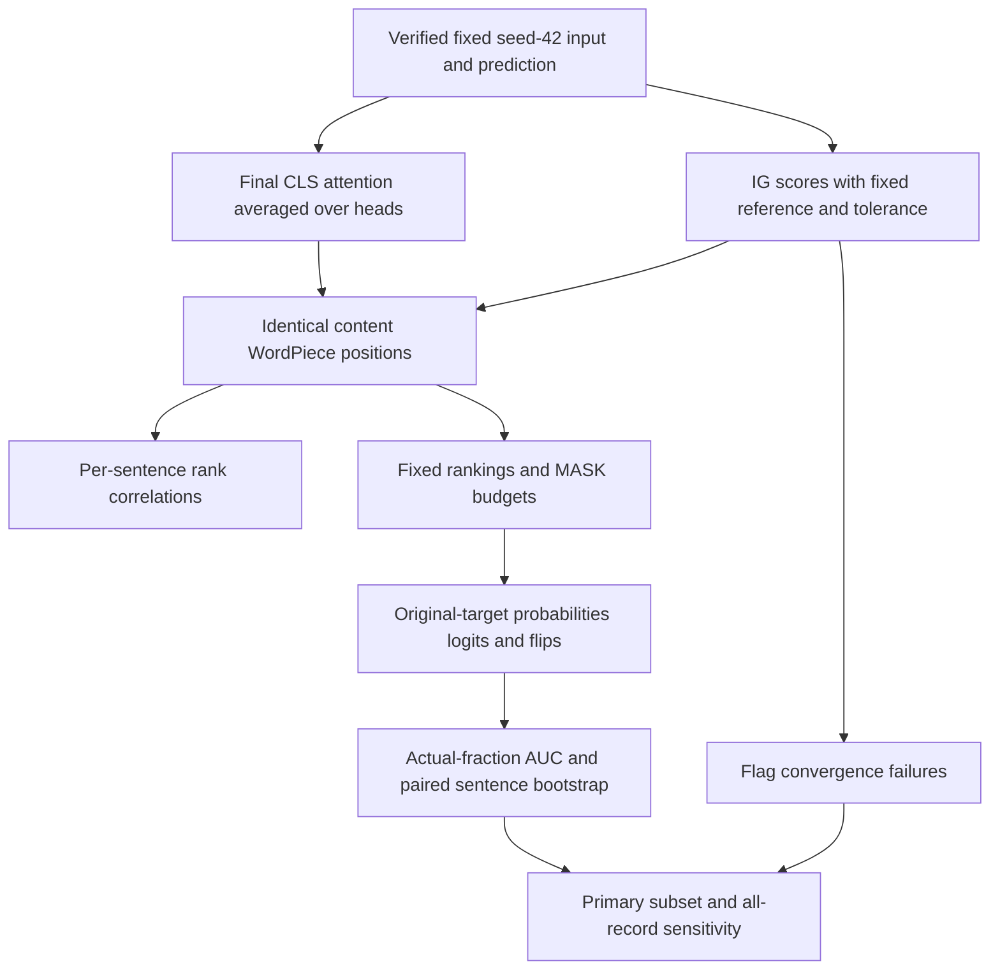

# 09 — Test explanation rankings without assuming one is right

**Before you begin:** Chapters 07 and 08 define the two score types. Chapter 05 introduces uncertainty. Here we calculate a rank correlation, draw a deletion curve and walk through resampling before interpreting the real results.

## Learning objectives

- Calculate rank agreement and a deletion area from short examples.
- Explain paired bootstrap sampling and the random baseline.
- Interpret the 687/727 comparison with the 40 unreliable records visible.

## Lesson: Compare two short ranked lists before calculating correlation

### Why it matters
IG and attention both assign scores to positions, but their units differ. Rather than comparing a logit contribution directly with an attention weight, ask whether they put the same positions near the top.

### Build the intuition
Ignore the raw score scale for a moment and compare order. Two methods agree perfectly if they order all tokens the same way; swapping a few positions weakens agreement.

### A concrete example
**Invented three-token example:** IG ranks `profit, rose, sharply`; attention ranks `profit, sharply, rose`. In the fixed token order `[profit,rose,sharply]`, their ranks are `[1,2,3]` and `[1,3,2]`.

### Walk through it
1. Check both methods refer to identical token IDs and positions.
2. Apply the same inclusion rule to both.
3. Replace scores by ranks.
4. Compare rank differences or pairwise ordering.
5. Calculate one coefficient per sentence, then summarize sentences.

### Give the idea its technical name
**Spearman correlation** measures association between ranks. **Kendall tau-b** compares concordant token pairs—ordered the same way—with discordant pairs, accounting for ties. A tie receives an averaged rank in Spearman.

### Add the mathematics
With no ties, $\rho=1-6\sum_i d_i^2/[n(n^2-1)]$, where n is token count and d_i is the difference between the two ranks of token i. Here differences are `[0,-1,1]`, squared total 2, so $\rho=1-12/24=0.5$. For tied values use rank correlation directly, not this simplified formula. Constant vectors have no meaningful rank correlation.

### Connect it to our project
[`correlations`](../src/finbert_explainability/phase5/analysis.py) requires aligned finite vectors and at least three eligible tokens. It compares absolute signed-sum IG with final-layer head-mean CLS attention. On 687 converged sentences, mean Spearman is 0.2406, median 0.2681, SD 0.2632 and bootstrap mean interval [0.2214,0.2607]. Signed-IG mean Spearman is 0.1008; mean absolute Kendall is 0.1724.

### Alternatives and trade-offs
Pearson correlation of raw scores asks about linear numerical association, which is different from ranking. Top-k overlap focuses only on the most emphasized positions, ignoring the rest. None makes one method the truth against which the other is automatically judged.

### Check your understanding
**Question:** Does mean Spearman 0.2406 mean the classifier is correct 24.06% of the time?

**Answer explained:** No. It describes average agreement between two token orderings. Classification accuracy is a separate calculation using sentiment labels.

### Deeper dive and common confusion
**Common confusion:** this is the mean of per-sentence coefficients, not a pooled correlation of every token in the test set. Pooling would give long sentences more weight and mix different score contexts. Padding, all special IDs and pure Unicode punctuation are excluded from both methods; currency/math symbols remain. Ordinary punctuation was retained in Phase 4 displays, so that display filter is not identical to this comparison filter.

## Lesson: Hide important tokens and read the curve

### Why it matters
If a ranking identifies influential input, what happens when we replace its highest-ranked tokens? We need a repeatable test, and we must be clear about what its score means.

### Build the intuition
Start with the original prediction. Replace more and more ranked tokens with MASK while tracking the probability of the original predicted class. A curve that falls earlier has less area below it. Under this test, that means stronger average suppression of the original prediction.

### A concrete example
**Invented curve:** mask fractions `[0,0.5,1]` and original-class probabilities `[0.9,0.5,0.2]`. Picture a line descending from 0.9 to 0.5 to 0.2. Its area is smaller than a curve that stays near 0.9 until the end.

### Walk through it
1. Fix the original predicted class and original ranking.
2. For each requested fraction, select the required number of top-ranked eligible positions.
3. Replace those IDs with MASK without changing positions or the original attention mask.
4. Run the fixed model and record all logits/probabilities and any class flip.
5. Plot original-class probability against the actual masked fraction.
6. Use trapezoids to calculate area under the curve.

### Give the idea its technical name
**Deletion AUC** here means the area under that probability curve, even though tokens are replaced rather than physically removed. **Trapezoidal integration** approximates each segment's area by width times the average of its two endpoint heights.

### Add the mathematics
For adjacent points (x_j,p_j) and (x_next,p_next), area is `(x_next−x_j)×(p_j+p_next)/2`. The toy curve gives `0.5×(0.9+0.5)/2 + 0.5×(0.5+0.2)/2 = 0.525`. x is the fraction masked; p is the probability of the fixed original class.

For n eligible tokens and fraction f, requested count is k=ceil(f×n), except zero stays zero. With n=7, both 5% and 10% request one token, so actual fraction is 1/7. Duplicate actual points are counted once when integrating.

### Connect it to our project
Budgets are 0, 0.05, 0.10, 0.20, 0.30, 0.50, 0.75 and 1.00. [`deletion_plan` and `auc_metrics`](../src/finbert_explainability/phase5/analysis.py) implement the counts and AUC; [inference.py](../src/finbert_explainability/phase5/inference.py) creates/evaluates the masked inputs. Primary mean AUC is IG 0.6555, attention 0.6608, random 0.7866. Lower means stronger suppression in this specific test.

### Alternatives and trade-offs
Removing words physically shifts positions. Whole-word masking avoids deleting only part of a WordPiece word but changes the budget unit. Language-model infilling can create more natural text but introduces another model and uncertain meaning changes. MASK replacement controls positions while creating artificial inputs.

### Check your understanding
**Question:** Why keep tracking the original class after the new prediction flips?

**Answer explained:** Otherwise the curve would change its target halfway through. Tracking whichever class is currently largest would answer a different question and could hide suppression of the original answer.

### Deeper dive and common confusion
**Common confusion:** MASK introduces distribution shift—inputs unlike ordinary financial sentences. It does not prove real-world causality. Negative probability/logit drops are retained because removing inhibitory evidence can raise confidence. Positive-only IG stops when positive scores run out; its mean coverage is 0.6628. Partial-area curves are not ranked against full-coverage AUCs.

## Lesson: Use random rankings and uncertainty to avoid a lucky comparison

### Why it matters
IG's mean AUC is slightly lower than attention's. Is that a clear difference, or could the observed set of sentences support either ordering? Random rankings also help show whether any token order would have worked similarly.

### Build the intuition
Compare methods on the same sentence, then repeatedly imagine a new test made by drawing sentences from the observed set with replacement. Keep each sentence's method scores together. Look at how much the mean difference varies.

### A concrete example
**Invented bootstrap example:** four sentence-level IG-minus-attention AUC differences are `[-0.02,0.01,-0.01,0.00]`, mean -0.005. Draw four IDs with replacement. `[1,1,3,4]` gives mean -0.0125; `[2,2,4,4]` gives +0.005. Repeated draws show how the mean depends on which sentences are represented.

### Walk through it
1. Generate five fixed random token orders for each sentence and average their AUCs within that sentence.
2. Compute IG-minus-attention and method-minus-random differences on each sentence.
3. Sample sentence IDs with replacement, retaining each paired difference.
4. Calculate the mean difference for each draw.
5. Repeat 2000 times and take the middle 95% by percentile endpoints.
6. Report the mean difference, interval and assumptions together.

### Give the idea its technical name
A **paired comparison** keeps methods matched on the same example. The **bootstrap sampling unit** is the object drawn each time—here a sentence. A **percentile confidence interval** uses quantiles of the repeated statistic. Chapter 05 introduced this distinction from seed SD.

### Add the mathematics
For N sentence differences d_i, mean difference is $\bar d=(1/N)\sum_i d_i$. Each bootstrap draw makes a new length-N sample of these differences with replacement. The 2.5th and 97.5th percentiles give the reported interval. The toy draws above teach the mechanics; they are not a reliable confidence analysis from only four examples.

### Connect it to our project
Random seeds are 11,23,37,53,71; a SHA256 combination with row ID produces repeatable per-row orderings. Bootstrap seed is 2042. IG-minus-attention mean is -0.0053 with interval [-0.0130,0.0024]. It includes zero, so this experiment does not clearly separate them. IG-minus-random is -0.1311; attention-minus-random -0.1258, with both intervals below zero.

### Alternatives and trade-offs
More random orders reduce sensitivity to one arbitrary ordering but do not multiply the number of independent sentences. Event-group resampling could account for shared news stories if trustworthy metadata existed. An equivalence test would require a meaningful tolerance chosen in advance; an interval crossing zero does not supply that tolerance.

### Check your understanding
**Question:** Why not treat all tokens, heads and five random orders as separate bootstrap examples?

**Answer explained:** They share the same sentence and model output. Pretending they are independent would exaggerate how much evidence we have and can make intervals too narrow.

### Deeper dive and common confusion
**Common confusion:** the CI concerns the mean statistic under these sampling assumptions, not a range containing 95% of individual token effects. Curve intervals are pointwise, and there is no correction for many comparisons. Similar stories can remain dependent. One fixed checkpoint also leaves variation across model seeds outside this interval.

## Lesson: Keep the failed calculations visible

### Why it matters
Forty IG records did not pass the fixed numerical rule. If we exclude them, are we silently changing the kind of sentences represented by the conclusion?

### Build the intuition
Report the reliable subset as the primary analysis, but also show what happens when every record is included with failures clearly marked. Compare the excluded group's makeup. Do not make the numerical rule easier after seeing the results.

### A concrete example
**Measured composition:** the 40 flagged examples contain 11 negative, zero neutral and 29 positive labels. Thirty-one are allagree, and the model classified 36 correctly. They are not simply the hardest classification errors.

### Walk through it
1. Keep all 727 records and their final convergence attempts.
2. Apply the unchanged absolute and relative tolerances.
3. Analyze the 687 passing records as primary.
4. Recalculate summary statistics for all 727, flagging unreliable IG.
5. Compare class, agreement, correctness, length and truncation counts.
6. Report what stays the same and what changes without claiming the groups are independent.

### Give the idea its technical name
An **exclusion sensitivity analysis** asks how conclusions change when a declared exclusion is varied in reporting. **Non-random exclusion** means the removed examples differ systematically from those retained. It can change the population described by an average.

### Add the mathematics
The flagged group is 40/727, about 5.50% of the test. Its mean eligible-token count is 28.6 versus 24.7 for passing records. Adding it changes mean Spearman from 0.2406 to 0.2465, a shift of approximately 0.0059. The groups overlap, so their intervals cannot be treated as independent comparisons.

### Connect it to our project
All 40 fail absolute tolerance 0.001 after 200 steps, although every relative residual is below 1%. Maximum absolute residual is 0.015395. All-record IG/attention/random AUCs are 0.6353/0.6372/0.7778; paired IG-minus-attention is -0.0019 with interval [-0.0097,0.0061], still including zero. [Phase 6 sensitivity](../artifacts/phase6/audit-final/ig_sensitivity.json) preserves exact values.

### Alternatives and trade-offs
Discarding failures without reporting composition would hide a selection effect. Treating them as fully reliable would ignore numerical evidence. A separately versioned experiment could investigate integration settings; it must preserve old thresholds and records rather than rewrite history.

### Check your understanding
**Question:** Can we say the exclusion has absolutely no material effect?

**Answer explained:** No. Means and composition do change, and no practical-materiality margin was chosen in advance. We can say the IG-versus-attention comparison remains unresolved in both summaries, while noting the numerical and population differences.

### Deeper dive and common confusion
**Common confusion:** the unreliable-only subset's paired result favors attention in direction, but it uses selected, numerically unreliable IG records. It cannot establish a method winner. Why those integrations fail numerically has not been isolated by this composition analysis.

## Follow the experiment from one sentence to a conclusion

The primary record set contains 80 negative, 432 neutral and 175 positive labels, with 307 allagree rows. The full set has 91/432/204 and 338 allagree. The excluded group has 2 truncated inputs; the full set has 15. There are no constant/too-short correlation failures among these 727 records, but the code returns undefined rather than zero if such a case appears.

| Population | N | Mean absolute Spearman | Mean Kendall | IG AUC | Attention AUC | Random AUC |
|---|---:|---:|---:|---:|---:|---:|
| Primary converged | 687 | 0.2406 | 0.1724 | 0.6555 | 0.6608 | 0.7866 |
| All, includes unreliable IG | 727 | 0.2465 | 0.1764 | 0.6353 | 0.6372 | 0.7778 |

**Check:** Which row gives the primary numerical claim? **Answer:** The converged row. The all-record row is a sensitivity result that deliberately contains unreliable IG estimates.

## Inspect more than one deletion summary

Any-budget flips are 0.4309 for IG, 0.4178 attention and 0.4684 random. Final-budget flip fraction is 0.3916 for all methods because all complete rankings eventually mask the same positions. Mean logit-drop AUC is 2.0677/1.9840/1.2460. Probability and logit changes have different units; larger logit-drop area and smaller remaining-probability area point toward stronger suppression. Mean within-sentence random-order AUC SD is 0.0991.

The result “both beat random in mean probability AUC” does not mean both win on every diagnostic or sentence. Absolute IG can rank opposing evidence highly. The signed-IG comparison and positive-only partial curves help expose that distinction.

**Check:** Does random having more any-budget flips contradict its higher probability AUC? **Answer:** No. A flip asks whether another class overtakes the original at any tested point. AUC summarizes its probability across the full path. They can rank methods differently.

## Runtime, files and what was not tested

The run processed 727 rows, reusing 10 Phase 4 records. Final integration-step counts were 151 at 50, 400 at 100 and 176 at 200. Wall time was 951.44 seconds; attention/deletion time 80.15 seconds; recorded IG time 830.38 seconds includes reused work and is not simply extra wall time. Peak allocated/reserved GPU memory was 0.567/0.641 GiB. Full summary: [JSON](../artifacts/phase5/full/summary.json). Implementation: [statistics.py](../src/finbert_explainability/phase5/statistics.py), [config](../configs/phase5.json). Figures: [paired AUC](../artifacts/phase5/full/figures/paired_auc.png), [deletion curves](../artifacts/phase5/full/figures/deletion_curves.png).

Future checks could retain only selected evidence (**sufficiency**), remove it and measure the lost evidence (**comprehensiveness**), add evidence back (**insertion**), or randomize learned weights to see whether explanations depend on training. Human-highlight overlap checks plausibility, not automatically the actual computation. Whole-word masking, natural contrast pairs and multiple model seeds would broaden the evidence. None was performed merely by being proposed here.

**Check:** What is the narrow conclusion we can defend? **Answer:** Under this fixed checkpoint, baseline, token filter and MASK protocol, the rankings have modest agreement; both suppress more than random on mean AUC, and IG versus attention is not clearly separated.

## Practice explaining it

1. **How is Spearman computed in the project?**

   One rank correlation per sentence, then a summary across sentences.

2. **Why integrate actual mask fractions?**

   Rounding token counts changes the realized fraction, especially in short sentences.

3. **Why average random orderings within each sentence first?**

   The sentence remains the evidence unit; random repeats reduce ordering noise.

4. **What does an interval including zero mean here?**

   The paired experiment does not clearly identify a directional difference, not that methods are proven equivalent.

5. **Why report the 40 cases separately?**

   Their numerical failure and different class mix make silent exclusion or unqualified inclusion misleading.

## Sources and next lesson

[Phase 5 report](../PHASE5_RESULTS.md), [Phase 6 report](../PHASE6_RESULTS.md), [IG and attention literature](references.md). Continue to [integrated discussion](10_results_and_discussion.md).
