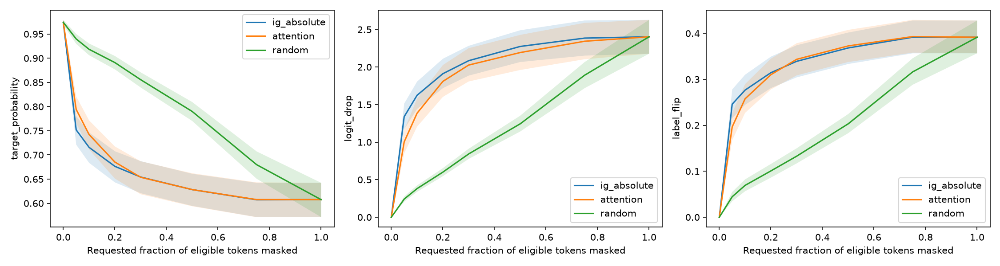
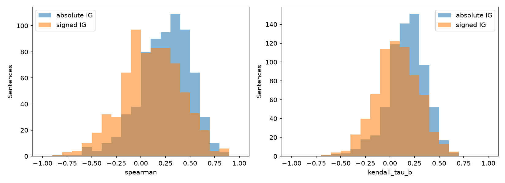
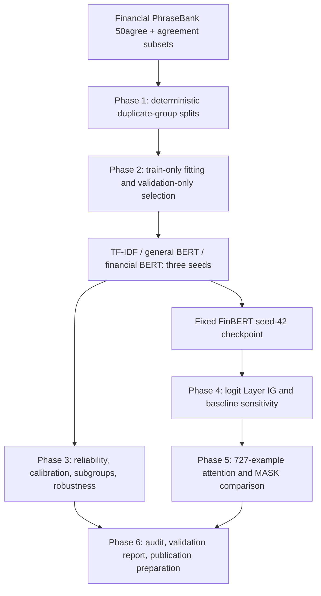

# FinBERT Explainability

**Does financial pretraining improve sentiment classification, and do attention weights behave like Integrated Gradients explanations?**

A six-phase, frozen-split evaluation of Financial PhraseBank using TF-IDF, general BERT and financial BERT. All findings below are measured results, not an assumed advantage for FinBERT. Publication is prepared locally; no repository has been pushed.

## Findings

| Independent workflow | Macro-F1: mean +/- sample SD | Accuracy: mean +/- sample SD |
|---|---:|---:|
| baseline | 0.6713 +/- 0.0000 | 0.7442 +/- 0.0000 |
| bert | 0.8476 +/- 0.0034 | 0.8556 +/- 0.0014 |
| finbert | 0.8339 +/- 0.0093 | 0.8469 +/- 0.0097 |

All workflows use the same 727-row test set and seeds 42, 123, 2026. General BERT has the higher mean macro-F1; three seeds do not justify a significance claim. ProsusAI/finbert is a **non-independent external reference** because Financial PhraseBank was part of its fine-tuning data; its 0.8797 macro-F1 is not a fair held-out ranking.

- BERT macro-F1 is 0.9583 on allagree versus 0.7500 on non-allagree examples.
- FinBERT seed-42 absolute IG versus final-layer head-mean CLS attention: mean per-sentence Spearman **0.2406** on the 687 converged examples, not a pooled token correlation.
- Mean original-class probability deletion AUC: IG **0.6555**, attention **0.6608**, random **0.7866**. Lower means stronger suppression under this MASK intervention.
- Paired IG-minus-attention 95% bootstrap CI **[-0.0130, 0.0024]** includes zero: no clear winner, not proof of equivalence.
- Forty IG records failed the unchanged absolute tolerance. Including all 727 changes Spearman to **0.2465** and the paired CI to **[-0.0097, 0.0061]**. The conclusion remains cautious; the excluded class mix is not random.
- PAD versus MASK baseline choice materially changes token rankings. MASK deletion introduces distribution shift and does not prove causality.

[Five-page validation report (PDF)](docs/model-validation.pdf) · [Report Markdown](docs/model-validation.md) · [Model card](MODEL_CARD.md) · [Reproducibility checklist](REPRODUCIBILITY.md) · [Licenses and release gates](LICENSE_REVIEW.md)




## Pipeline



`src/finbert_explainability/phase2` through `phase6` contain modular CLI workflows. Phase 1 is the package's root CLI. Configurations pin model revisions, data hashes, seeds and experiment settings. A completed output directory is protected against overwrite. The Phase 4 and 5 pipelines support checksummed record resumption.

## Dataset and intended use

Financial PhraseBank `sentences_50agree`: 4,846 sentences; train/validation/test = **3,391/728/727**. Canonical labels are negative=0, neutral=1, positive=2. Exact/near duplicate grouping leaves zero detected cross-split pairs under the declared lexical detector, not a guarantee against semantic or pretraining overlap. The deterministic regrouping reassigned 2,199 rows, including 2,143 singletons; no rows were lost.

[Financial PhraseBank](https://huggingface.co/datasets/takala/financial_phrasebank) is listed as **CC BY-NC-SA 3.0**. Obtain the pinned source through the supplied configuration and respect attribution, noncommercial and share-alike terms. Raw sentences, derived row-level exports, downloaded datasets and checkpoints are not in this publication package. Model and data rights are separate from the owner-selected code license, which remains pending. See [license review](LICENSE_REVIEW.md).

Use for financial-language research or supervised evaluation. This is not a validated trading, credit, compliance or investment decision system. Temporal/domain validation, risk calibration, human oversight and rights clearance are needed before deployment.

## Environment and installation

Historical environment: Python 3.11.15; Windows `rag-env`; NVIDIA RTX 4070 Laptop GPU (8 GB); CUDA 12.6; PyTorch **2.12.1+cu126**. Do not replace PyTorch in the existing environment.

```powershell
conda activate rag-env
$env:PYTHONPATH = (Resolve-Path src).Path
$env:PYTHONDONTWRITEBYTECODE = '1'
python -c "import sys,torch; print(sys.executable,torch.__version__,torch.version.cuda); print(torch.cuda.is_available())"
python -m pip install -e . --no-deps --no-build-isolation
```

The editable install is optional; PYTHONPATH is sufficient. `requirements/research-pinned.txt` records tested non-Torch direct dependencies, and `requirements/constraints-observed.txt` pins the observed Torch build. These are not a universal cross-platform lock or proof that every historical wheel remains available. A fresh environment requires a compatible CUDA driver and verified availability of the exact Torch build; consult the [official PyTorch installation guidance](https://pytorch.org/get-started/locally/). Do not silently substitute a different build. Report generation additionally uses ReportLab 4.4.9 and the pinned PDF tools. The original project pyproject has broad bounds and omits several later-phase dependencies; use the accompanying pins for a reviewed reconstruction.

## Reproduction commands for every phase

The following are documented historical workflows, **not commands executed by Phase 6**. Run only in a fresh workspace or use new output/config paths. The `--approve-training` flags below are for a separately approved Phase 2 reproduction; they do not authorize any training during this audit.

```powershell
python -m finbert_explainability --config configs/phase1.json
python -m finbert_explainability.phase2 audit --phase1 artifacts/phase1 --output artifacts/phase2/audit
python -m finbert_explainability.phase2 smoke --output artifacts/phase2/smoke-final
python -m finbert_explainability.phase2 train baseline --config configs/phase2.json --output artifacts/phase2/baseline --approve-training --smoke-receipt artifacts/phase2/smoke-final/smoke_receipt.json
python -m finbert_explainability.phase2 train bert --config configs/phase2.json --output artifacts/phase2/bert --approve-training --smoke-receipt artifacts/phase2/smoke-final/smoke_receipt.json
python -m finbert_explainability.phase2 train finbert --config configs/phase2.json --output artifacts/phase2/finbert --approve-training --smoke-receipt artifacts/phase2/smoke-final/smoke_receipt.json
python -m finbert_explainability.phase2 evaluate --run artifacts/phase2/baseline --output artifacts/phase2/baseline-evaluation
python -m finbert_explainability.phase2 evaluate --run artifacts/phase2/bert --output artifacts/phase2/bert-evaluation
python -m finbert_explainability.phase2 evaluate --run artifacts/phase2/finbert --output artifacts/phase2/finbert-evaluation
python -m finbert_explainability.phase2 reference --config configs/phase2.json --output artifacts/phase2/reference
python -m finbert_explainability.phase2 compare --runs artifacts/phase2/baseline-evaluation artifacts/phase2/bert-evaluation artifacts/phase2/finbert-evaluation artifacts/phase2/reference --output artifacts/phase2/comparison
python -m finbert_explainability.phase3 smoke --output artifacts/phase3-smoke
python -m finbert_explainability.phase3 analyze --config configs/phase3.json --smoke-receipt artifacts/phase3-smoke/smoke_receipt.json
python -m finbert_explainability.phase4 smoke --output artifacts/phase4/smoke
python -m finbert_explainability.phase4 run --config configs/phase4.json
python -m finbert_explainability.phase5 cpu-smoke --output artifacts/phase5/cpu-smoke
python -m finbert_explainability.phase5 run --config configs/phase5/cuda-smoke.json --smoke
python -m finbert_explainability.phase5 run --config configs/phase5.json
python -m finbert_explainability.phase6 audit --output artifacts/phase6/audit-final
```

Full private artifact access is required to replay the exact historical evaluation and audit. The public package intentionally omits models/data. Rebuilding data can reproduce assignments with matching software/source but metadata and manifest bytes may differ; never change the historical hashes to hide that difference. Use copied configs for genuinely new runs. The Phase 3 smoke receipt binds its source code; Phase 4/5 resumption binds input and implementation hashes. Do not retune from this already-examined test set.

```powershell
python -m finbert_explainability.phase5 run --config configs/phase5.json --resume
python -m pytest tests -q -p no:cacheprovider --basetemp artifacts/phase6/tests-fresh
```

The numerical audit has no model inference or training. It recomputes metrics from saved records and verifies manifests. README workflow flags are automatically parsed by the actual CLI parsers with dispatch blocked.

## Explainability example

Measured example `fpb50-00018`, fixed FinBERT seed 42: true/predicted positive, probability 0.9936. Under the PAD reference, the WordPiece `double` contributes approximately +2.783 to the **positive-class logit difference**. This is a local, baseline-dependent attribution, not proof of a causal financial effect. Full sentence/token exports remain local; the small attribution fragment is dataset-derived and subject to the source rights review. The report also covers misclassifications rather than presenting only successful examples.

## Limitations and annotation provenance

- Three training seeds, one explanation checkpoint, one benchmark and no new temporal holdout.
- 64-token cap; 15 Phase 5 examples truncated. Calibration and subgroup variation matter.
- ECE is bin-dependent; no test-set calibration fitting. Rule-based perturbations have unvalidated gold labels.
- All 20 selected error categories were supplied by the user; interpretation/comments contain labeled AI-assisted drafts. This is not independent human validation, and the selected sample is not representative.
- Forty numerically unreliable IG records are retained; primary and all-record sensitivity results are distinguished.
- Attention is class-agnostic while IG targets a class logit. Correlation is not faithfulness; deletion tests are imperfect interventions. Special-token attention is not inherently unfaithful.
- Sentence bootstrap intervals ignore possible remaining topical dependence and are not multiplicity-adjusted.
- A known authorized annotation CSV change differs from the original Phase 3 manifest; that manifest remains unchanged.

## References

[Financial PhraseBank](https://huggingface.co/datasets/takala/financial_phrasebank) · [General BERT](https://huggingface.co/google-bert/bert-base-uncased) · [Financial pretraining checkpoint](https://huggingface.co/yiyanghkust/finbert-pretrain) · [ProsusAI reference](https://huggingface.co/ProsusAI/finbert) · [Guo et al., calibration](https://proceedings.mlr.press/v70/guo17a.html) · [Sundararajan et al., IG](https://arxiv.org/abs/1703.01365) · [Jain & Wallace, Attention is not Explanation](https://aclanthology.org/N19-1357/) · [Wiegreffe & Pinter, Attention is not not Explanation](https://aclanthology.org/D19-1002/).

This experiment evaluates related diagnostics, not every control proposed in those papers. It supports neither a universal dismissal nor a universal endorsement of attention explanations.
