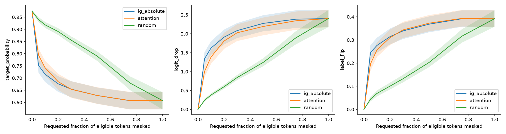

# FinBERT Explainability: model validation report

## Decision and benchmark performance

Model validation report | FinBERT Explainability | 29 October 2026 | Research evaluation, not production certification

### Executive decision

Recommend supervised research or a monitored human-review pilot only. The evidence does not support autonomous trading, lending, or other consequential financial decisions. General BERT is the stronger mean-performing candidate on this benchmark; financial pretraining did not improve the measured three-seed mean. Prioritize temporal and out-of-domain validation, validation-only calibration, error-cost analysis, and rights clearance before deployment.

### Intended use and dataset

English financial sentence sentiment: negative (0), neutral (1), positive (2). Financial PhraseBank sentences_50agree has 4,846 rows, with 604 negative, 2,879 neutral and 1,363 positive labels; 2,264 rows belong to allagree. Labels reflect annotator judgments, not realized returns or investment value. The task does not establish multilingual, document-level, current-market, or predictive-return capability.

| Split | Rows | Negative | Neutral | Positive |
| --- | --- | --- | --- | --- |
| Train | 3391 | 422 | 2015 | 954 |
| Validation | 728 | 91 | 432 | 205 |
| Test | 727 | 91 | 432 | 204 |

The initial stratified 70/15/15 split was rebuilt deterministically with intact lexical duplicate groups: 8 exact and 49 near pairs, 25 initial crossings and zero final crossings under the declared detector (character 3-5-gram cosine >=0.90). All 2,199 reassigned rows are retained: 2,143 singletons and 56 grouped rows moved because the algorithm rebuilt all assignments, not because there were 2,199 duplicates. Semantic or pretraining overlap is not ruled out.

### Same frozen 727-row test set; three seeds

| Independent workflow | Macro-F1, mean +/- SD | Accuracy, mean +/- SD |
| --- | --- | --- |
| TF-IDF + logistic regression | 0.6713 +/- 0.0000 | 0.7442 +/- 0.0000 |
| General BERT | 0.8476 +/- 0.0034 | 0.8556 +/- 0.0014 |
| Financial BERT | 0.8339 +/- 0.0093 | 0.8469 +/- 0.0097 |

Sample SD uses ddof=1 across seeds 42, 123, 2026; it is not a confidence interval. TF-IDF fits training text only; model selection uses validation only. The identical baseline scores across seeds do not establish universal determinism. Three seeds give limited variance information. No significance claim about BERT versus FinBERT is made.

ProsusAI/finbert scores macro-F1 0.8797 and accuracy 0.8900, but was fine-tuned on Financial PhraseBank. Potential overlap makes it a non-independent external reference, not a valid winner over the held-out workflows. It has no three-seed SD.

## Reliability and qualitative review

### Annotator-agreement subgroups

| Workflow | Allagree macro-F1 | Non-allagree macro-F1 |
| --- | --- | --- |
| baseline | 0.8163 +/- 0.0000 | 0.5182 +/- 0.0000 |
| bert | 0.9583 +/- 0.0094 | 0.7500 +/- 0.0142 |
| finbert | 0.9553 +/- 0.0026 | 0.7262 +/- 0.0156 |

Allagree: 338 rows (50 negative / 209 neutral / 79 positive). Non-allagree: 389 (41 / 223 / 125). Small class counts and different composition limit conclusions. Agreement is observational; the gap does not show that disagreement causes model errors. Exact annotator vote counts were not released; membership bands cannot recover those counts.

### Raw probability calibration

| Workflow | ECE-10 | ECE-15 | Brier | NLL |
| --- | --- | --- | --- | --- |
| baseline | 0.0701 | 0.0730 | 0.3674 | 0.6320 |
| bert | 0.1064 | 0.1088 | 0.2468 | 0.5115 |
| finbert | 0.0923 | 0.0944 | 0.2620 | 0.6022 |

Calibration entries are three-seed means; complete SDs and bin counts are in Phase 3. FinBERT ECE-10 SD is 0.0556. ECE uses equal-width confidence bins; Brier sums squared error across the three classes (range 0-2); NLL clips at 1e-15. No temperature scaling was fitted. Bin-sensitive ECE alone is not a calibrated-risk guarantee.

### Deterministic robustness probes

| Workflow | Company flip rate | Numerical flip rate | Negation flip rate |
| --- | --- | --- | --- |
| baseline | 0.2019 | 0.0769 | 0.0640 |
| bert | 0.0128 | 0.0031 | 0.2255 |
| finbert | 0.0192 | 0.0000 | 0.1889 |

Eligible counts are 104 company substitutions, 109 numerical edits and 375 negations. Rates use model-visible changes; denominators differ by tokenizer. Company and amount replacements are conditional-invariance probes; negation has no prescribed target class. Grammar and sentiment changes are unvalidated. Low flip rates do not establish semantic robustness, and negation need not reverse financial sentiment.

### Completed categories; AI-assisted explanatory notes

All 20/20 user-supplied error categories are filled. Counts: complex sentence 1, entity context 7, financial context 4, implicit sentiment 4, label ambiguity 1, negation 2, numerical reasoning 1.

The 20 rows were selected for confident errors and model disagreement, not sampled randomly. Fourteen have at least 25% annotator disagreement; nine are in the 34%-to-less-than-50% band. These proportions cannot describe the full test population. Interpretations and comments in all 20 rows contain labeled AI-assisted drafts; they are not independent human-validated causal assessments. Categories were not recoded to fit a hypothesis. The original Phase 3 report still describes its earlier blank handoff and is preserved as historical.

## Integrated Gradients and exclusion sensitivity

### Fixed explanation protocol

Primary checkpoint: saved yiyanghkust/finbert-pretrain fine-tune, seed 42, fixed before explanation generation rather than selected by test performance. Captum LayerIntegratedGradients targets the original predicted-class logit at model.bert.embeddings in eval mode. The PAD-content reference preserves CLS, SEP, padding, positions and attention masks. Signed embedding-dimension sums are retained separately from their absolute values. Content rankings exclude specials/padding; Phase 5 also excludes punctuation.

Integration uses the unchanged 50/100/200-step schedule, absolute residual <=0.001 and relative residual <=0.01, with denominator floor 1e-6. Completeness includes every embedding position. No thresholds were changed post hoc. Forty of 727 records fail the absolute tolerance; their maximum absolute residual is 0.015395. All relative residuals remain below 1%. These records are saved and explicitly marked unreliable, not silently discarded.

Phase 4 compared PAD and MASK references on four fixed examples. Absolute-rank Spearman ranged from 0.1980 to 0.6443; top-5 Jaccard ranged from 0.2500 to 0.6667. Reference choice materially changes rankings even when numerical completeness passes. Both references are artificial attended sequences; neither is a neutral financial sentence or a universally correct baseline.

### Who is excluded?

| Population | N | Gold neg/neu/pos | Allagree | Correct | Truncated |
| --- | --- | --- | --- | --- | --- |
| converged | 687 | 80/432/175 | 307 | 587 | 13 |
| unreliable | 40 | 11/0/29 | 31 | 36 | 2 |
| all | 727 | 91/432/204 | 338 | 623 | 15 |

The excluded records contain no neutral gold labels: 11 negative and 29 positive, with 31/40 allagree and 36/40 correct predictions. Mean eligible-token length is 28.6 versus 24.7 in the converged subset. Exclusion is not random and shifts the analyzed class and agreement mix; primary results should not be described as automatically representative of all 727 examples.

| Population | Mean Spearman | Mean Kendall | IG AUC | Attention AUC | Random AUC |
| --- | --- | --- | --- | --- | --- |
| converged | 0.2406 | 0.1724 | 0.6555 | 0.6608 | 0.7866 |
| all | 0.2465 | 0.1764 | 0.6353 | 0.6372 | 0.7778 |

Adding all 40 flagged records shifts mean Spearman by 0.0059. The paired IG-minus-attention probability-AUC mean is -0.0053 with 95% CI [-0.0130, 0.0024] for 687 rows, versus -0.0019 with [-0.0097, 0.0061] for all 727. Both intervals include zero. The main directional conclusion is unchanged, but metric magnitudes and composition do change; no practical-materiality margin was prespecified.

The unreliable 40 alone have a positive IG-minus-attention AUC difference, but their IG integration is unreliable and the subset is small and selected. That result is diagnostic, not a basis for declaring attention superior. The full and converged populations overlap; their intervals are not independent comparisons.

## Attention comparison and intervention evidence

### Correlation is not faithfulness

The final layer CLS-to-token attention is averaged across 12 heads. All 12 layers and heads have raw CLS rows saved per example. Attention is not conditioned on the chosen class, whereas IG is. Rankings use identical content WordPieces: special IDs, padding and all-Unicode-punctuation tokens are excluded; symbols and numerical content remain. Spearman uses tied average ranks and Kendall uses tau-b; fewer than three tokens or constant vectors would be undefined.

On 687 converged rows, absolute IG-attention Spearman mean is 0.2406 (95% CI [0.2214, 0.2607]), Kendall mean 0.1724. Signed-IG Spearman is 0.1008. These are modest average rank associations, not proof of causal explanation quality.

### Fixed-rank MASK deletion

Budgets are 0%, 5%, 10%, 20%, 30%, 50%, 75% and 100% of eligible tokens, rounded upward. Positions and masks remain fixed. The original predicted-class probability/logit are measured after masking. AUC integrates actual masked fractions; lower probability AUC means stronger suppression. Five fixed random orderings are averaged per sentence. Positive-only IG stops when positive scores run out and is a separate partial-coverage sensitivity analysis.

Mean probability AUC: absolute IG 0.6555, attention 0.6608, random 0.7866. Paired mean differences versus random are -0.1311 for IG and -0.1258 for attention, with both bootstrap intervals below zero. IG versus attention is not resolved: CI [-0.0130, 0.0024] includes zero. A null-including interval is not proof of equivalence. Heterogeneous per-example behavior remains important.

Any-budget flip rates are 43.1% (IG), 41.8% (attention), and 46.8% (random ordering mean). Every method shares the same 100%-mask endpoint. Different diagnostics need not rank methods identically.

### Special tokens and scope of claims

Across all 727 examples, final-layer head-mean CLS attention mass is 10.46% on CLS, 29.80% on SEP, 7.04% on punctuation and 52.70% on content (other specials approximately 0.005%; padding zero). Contextual special-token representations can carry information; mass there alone does not establish unfaithfulness.

MASK replacements induce distribution shift and can remove part of a WordPiece word. These are imperfect interventions, not proof of causality or ground-truth fidelity. Results concern one checkpoint, one layer aggregation and this benchmark. They are related diagnostics to Jain and Wallace (2019), but do not reproduce alternate-attention interventions. Wiegreffe and Pinter (2019) emphasize explanatory definitions and model-level controls; their adversarial-training and multi-seed attention tests were not performed here.

## Reproducibility, release controls and references

### Audit verdict

30 saved input/output manifests and 3025 checksum entries were audited, including smoke runs. Classification, calibration, subgroup and robustness metrics were recomputed from saved predictions. Phase 4 sensitivity and Phase 5 bootstrap/statistical summaries were recomputed from saved records; no models were run or trained. All numeric report claims were regenerated with metric labels preserved. 3212 earlier files remain byte-identical.

Known exception: the Phase 3 human_annotation.csv changed after its manifest was sealed, as authorized by the user. Its current and sealed hashes are both recorded; the old manifest was not rewritten. The historical blank-annotation statement is no longer current. Pytest scratch is outside the scientific manifest inventory. The final audit retains this distinction rather than claiming every old manifest entry currently matches.

Frozen test SHA256: 97ad15089bd04e0d61726a6218bfcc2bdb18a4bcc1f5e8a299e1da41607e36a9. The existing Python 3.11 rag-env and PyTorch 2.12.1+cu126 were used without replacement. Pinned dependency inventory and model revisions are supplied. Phase 5 used 951.44 s wall time and 0.567 GiB peak allocated CUDA memory; 10 completed IG records were reused.

### Uncertainty and next validation

Seed SD is not statistical significance. Explainability intervals use 2,000 fixed-seed percentile bootstrap resamples of sentences; paired comparisons resample within-sentence differences. Tokens, heads and random orderings are not independent sampling units. Similar texts may remain dependent, intervals are pointwise and not multiplicity-adjusted, and no temporal/external holdout was evaluated. The 64-token cap truncates 15 Phase 5 examples.

Next steps: prospectively evaluate a new time period and target domain; validate error costs and abstention; fit calibration only on validation data; obtain independent human review of qualitative notes; assess longer text and semantic leakage; pre-register further reference/attention controls. Preserve this test set as already examined. Do not tune model or attribution settings from these findings.

### Publication readiness and rights

GitHub publication is prepared, not performed. Raw text, per-example exports, caches and weights are excluded by default. Financial PhraseBank is listed as CC BY-NC-SA 3.0; the current ProsusAI card lists CC BY-NC-SA 4.0; the financial pretraining model has unclear license metadata. Current cards do not establish the exact pinned revision rights. Owner selection of a code license, upstream/pinned-model rights review, final secret review, repository/visibility choice and explicit publication approval remain manual gates.

### References

[1] Financial PhraseBank, Malo et al. Dataset and source license: https://huggingface.co/datasets/takala/financial_phrasebank
[2] General BERT and financial pretraining model cards: https://huggingface.co/google-bert/bert-base-uncased ; https://huggingface.co/yiyanghkust/finbert-pretrain
[3] ProsusAI reference: https://huggingface.co/ProsusAI/finbert
[4] Guo et al. (2017), calibration: https://proceedings.mlr.press/v70/guo17a.html
[5] Sundararajan et al. (2017), IG: https://arxiv.org/abs/1703.01365 ; Captum: https://captum.ai/api/layer.html
[6] Jain & Wallace (2019): https://aclanthology.org/N19-1357/
[7] Wiegreffe & Pinter (2019): https://aclanthology.org/D19-1002/
